# Ideas

## The principality

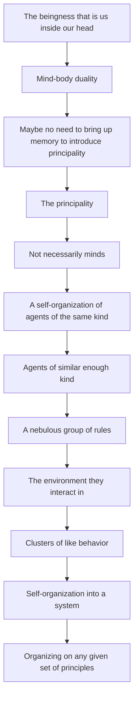

## Nations, cities, clubs, and churches

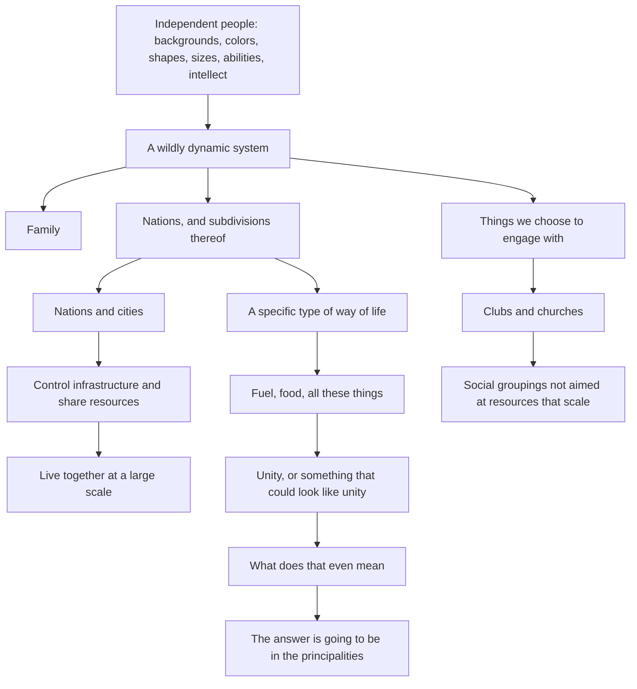

## Who am I

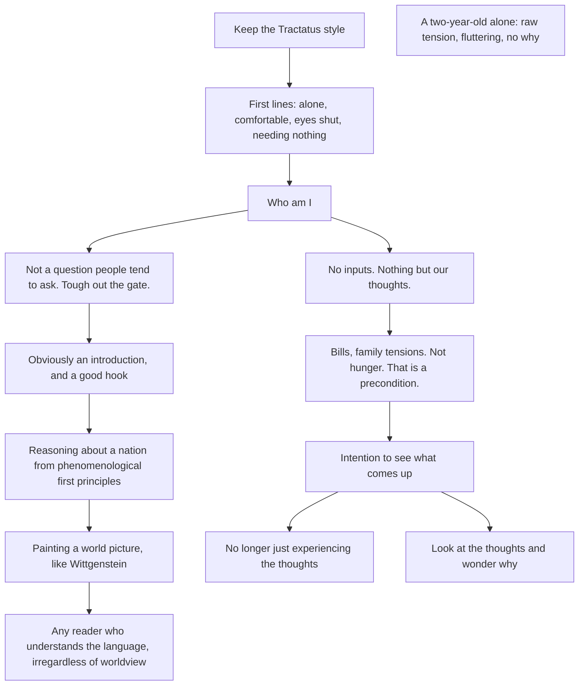

## What am I if not my thoughts

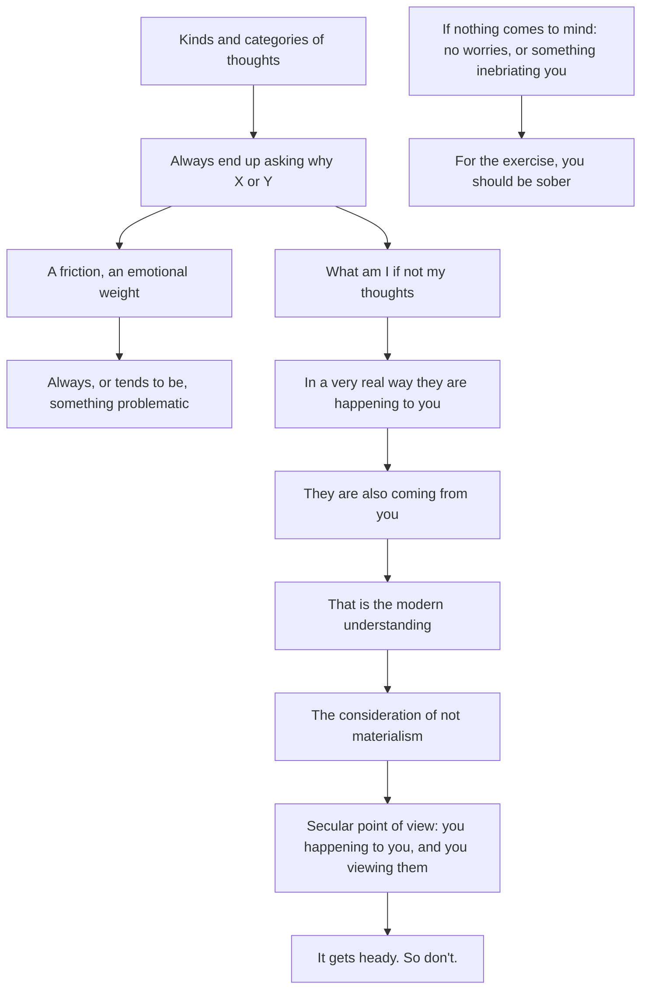

## Mercury, Mars, and the subconscious

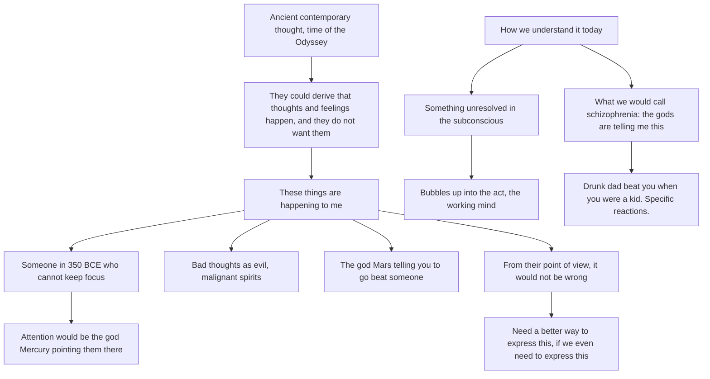

## God is dead, but it's not true

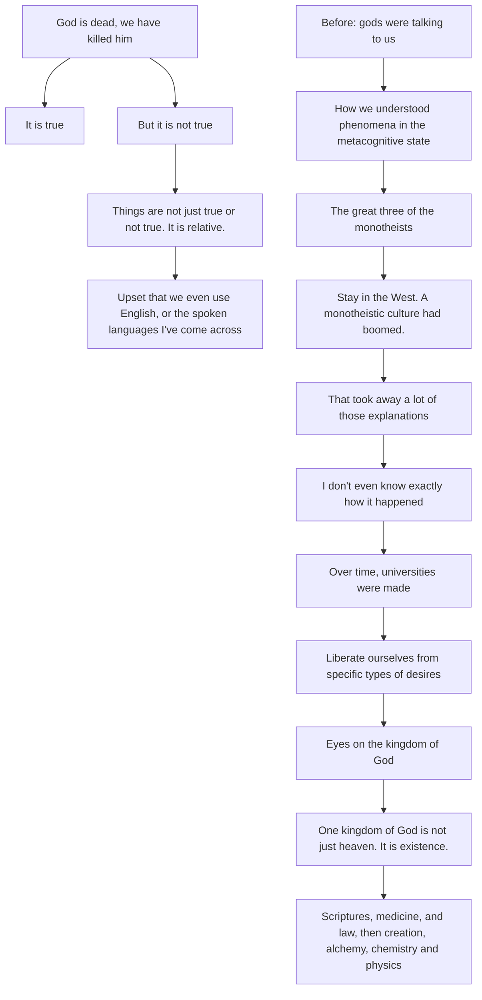

## After Martin Luther

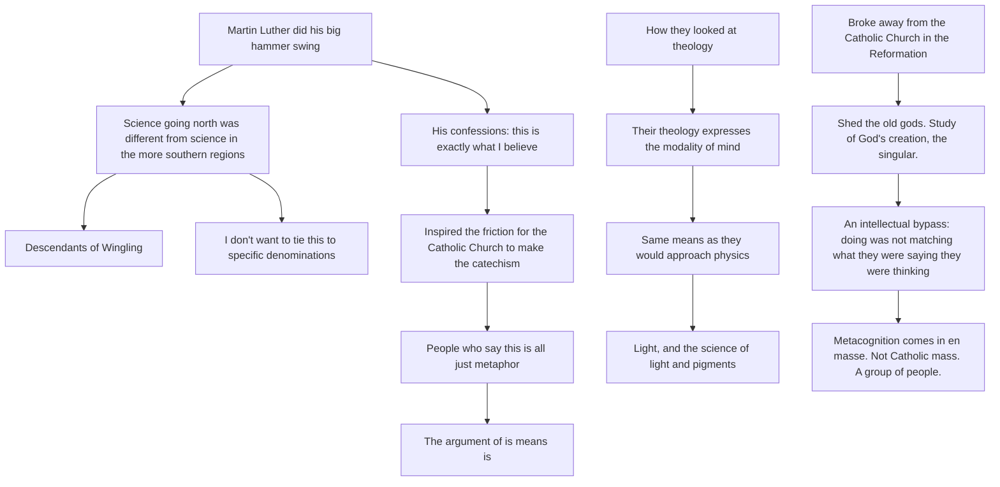

## Different shades of a principality

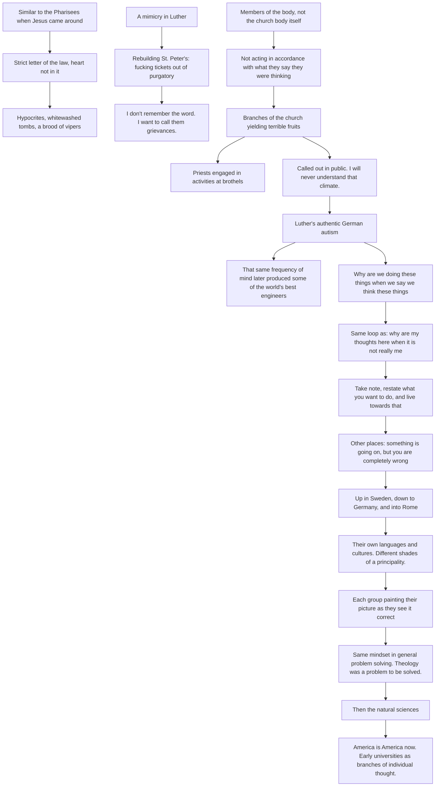

## The gods of old are the archetypes

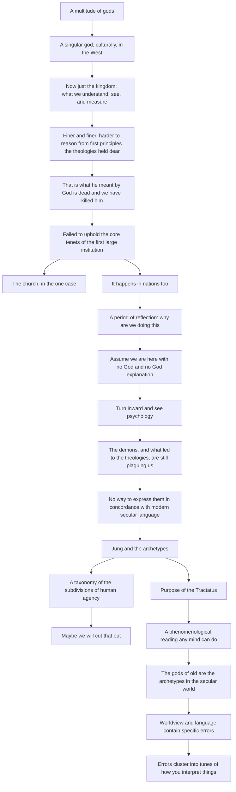

## Like minds, and the ant colony

```mermaid
flowchart TD
  what["What is it"]
  what --> modality["A mindset to modality"]
  modality --> likeMinds["We group together with like minds"]
  likeMinds --> agency["The group acts as if it has agency through the members of the body"]
  agency --> ants["Similar to an ant colony, working with a higher purpose"]
  ants --> role["The ant only knows its role"]
  role --> west["Each member of Western culture is fulfilling specific roles"]
  west --> unintended["Roles not necessarily intended, but people are there to fill them"]
  unintended --> notTask["Not necessarily a task. Not building towards something."]
  notTask --> time["It is just happening because time is happening"]
  time --> secular["From a secular perspective"]
  secular --> mystery["Having removed the mystery"]
  mystery --> backfill["Conclusions backfill spaces the mystery used to provide pressure in"]
  backfill --> hard["Putting that in English is hard as fuck"]
  hard --> notJustReligion["Not just religion filled that role"]
  notJustReligion --> family["There was also family and meaning"]
  family --> lost["Something lost with pure secular society"]
  lost --> isolation["Causing isolation between people"]
  isolation --> assumptions["Because everyone has certain assumptions"]
```

## Layers of nothing

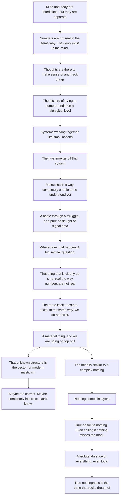

## Something, the all thing, and the receptacle

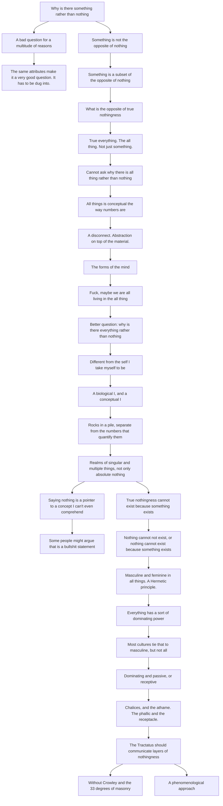

## Caught in a stream

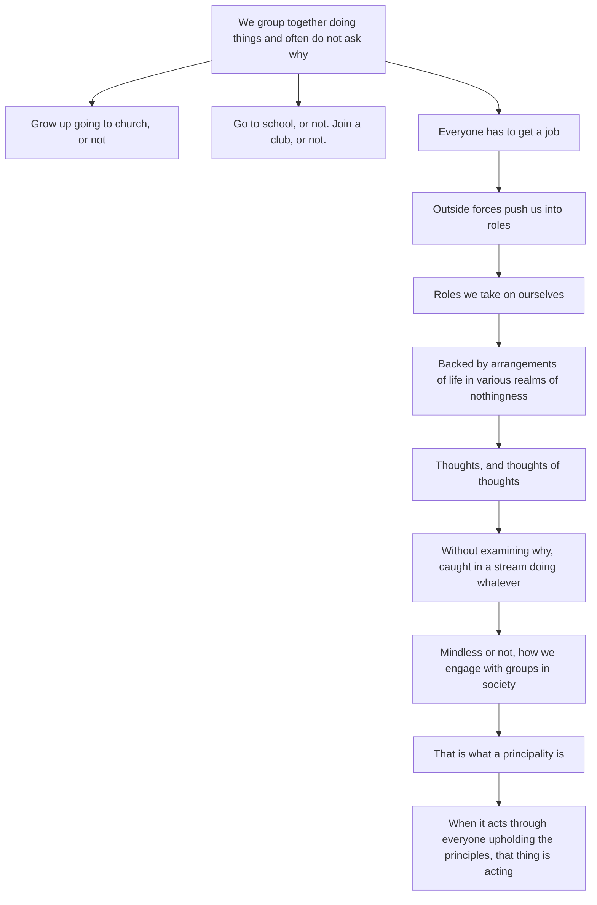

## America's dead, and the West is dead

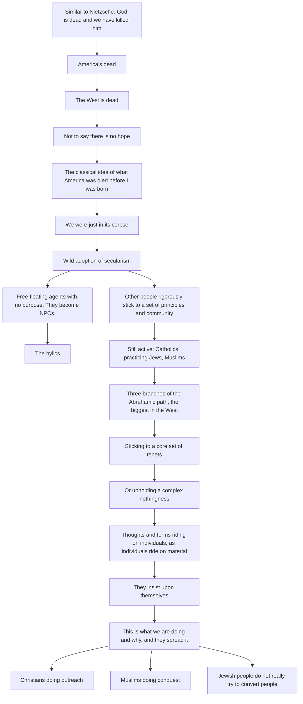

## A measure system and a rule system

```mermaid
flowchart TD
  body["A body of believers around core tenets, as there is a nation or a state"]
  body --> over["Something exists over each of those groups"]
  over --> through["Operates in this world through people, as we operate through ourselves"]
  through --> numbers["As numbers are used to count things, but much more complex"]
  numbers --> both["Not just a measure system. A rule system as well."]
  both --> see["This is how you see a thing. This is how you measure a thing."]
  see --> behave["When you see this group of measurements, this is how you should behave"]
  behave --> thousand["A thousand people who believe the same core tenets"]
  thousand --> routine["Outside the group, a pattern triggers a routine of behavior"]
  routine --> flavored["Flavored to the individual, but directionally what the tenets suggest"]
  flavored --> bothLevels["Consciously and unconsciously, subconsciously"]
  bothLevels --> hylicsToo["Even the hylics are driven by this"]
  hylicsToo --> uninstalled["Mass isolation and technology: we uninstalled ourselves from these tenets"]
  uninstalled --> noTenets["Secularism does not offer tenets anymore"]
  noTenets --> corpse["Still riding off the corpse of the West"]
  corpse --> rights["The Constitution: manner imbued with certain inalienable rights, by God"]
  rights --> great["Obviously great for our system of morality"]
  great --> strife["Strife downstream, because a lot of people do not believe in God"]
  strife --> whyRights["Why do people even have rights"]
  whyRights --> dangerous["A dangerous question. Justify no rights, and you can justify horrible things."]
  dangerous --> tuned["Horrible is tuned to my death Western understanding of good and bad"]
  tuned --> relativism["Moral relativism caught on in this secular world"]
  relativism --> prove["I'm not doing anything you can't prove"]
  prove --> woman["Next, people wondering what even a woman is"]
```

## What a woman is

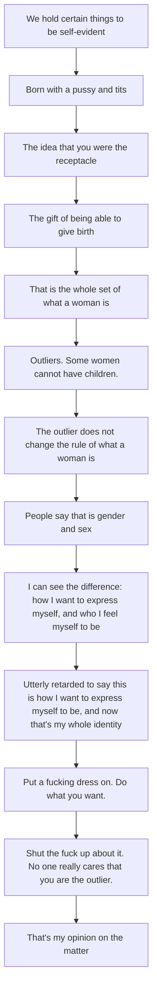

## What the fuck are we even doing here

```mermaid
flowchart TD
  question["What the fuck are we even doing here"]
  question --> noGod["If there is no God, and everything is secular"]
  noGod --> gaps["Gaps in our understanding, and nothing to fill them"]
  gaps --> unease["That unease"]
  unease --> whirlwind["People who cannot self-analyze well, driven into a whirlwind"]
  whirlwind --> told["Told they have to believe certain things they cannot justify"]
  told --> liberate["They could liberate themselves by not giving a shit"]
  liberate --> whoIAm["This is who I am. This is how I want to be."]
  whoIAm --> leave["If you do not like it, leave the group"]
  leave --> dangerous["I think that's just all so fucking dangerous"]
  dangerous --> offTrack["Off the track of existential coordination"]
  offTrack --> cancer["They really become like a cancer"]
  cancer --> attitudes["Self-destructive attitudes, the nothing, the laissez-faire bullshit"]
  attitudes --> aliens["Some say we need aliens, or a big conflict"]
  aliens --> wont["A big conflict just will not do it anymore"]
  wont --> unknown["I don't know what would backfill purpose and realign people"]
  unknown --> satted["Other than a very simple, satted stage towards enlightenment"]
  satted --> absurd["Sounds absolutely absurd, but that is what I'm trying to do"]
  absurd --> agents["We are agents in this world"]
  agents --> engage["We engage in things without full understanding"]
  engage --> error["When we error, it is almost always detrimental"]
  error --> christians["Essentially what the Christians have been saying this whole time"]
  christians --> peterson["Maybe what Jordan Peterson was hooting at"]
  peterson --> bible["The Bible is not necessarily even true"]
  bible --> gauge["It is the set of preconditions on which you can gauge truth"]
```
